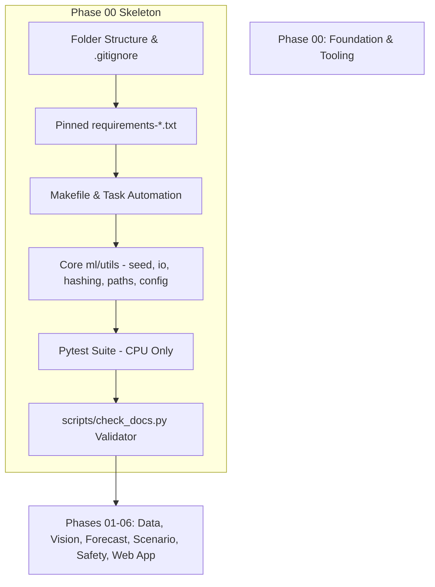

# Phase 00 Documentation: Repository, Tooling & Documentation System

---

## 1. In One Sentence: What This Phase Does
Phase 00 establishes a clean, fully tested repository skeleton, dependency configuration files, core utility modules for secure data processing and hashing, automated unit test suites, and a beginner-friendly documentation framework for **crop-prognosis**.

---

## 2. Why This Step Exists (The Real-World Problem It Solves)
Before building machine learning models or writing web servers, software projects need a reliable structural foundation. In real-world machine learning engineering, projects without standard folder layouts, pinned dependency versions, and security guardrails quickly suffer from chaotic bugs:
- **Dependency Drift**: Code breaks because a third-party library update changed how functions work.
- **Security Vulnerabilities**: Using unsafe object storage formats (like Python's `pickle`) allows malicious code to compromise computers.
- **Environment Inconsistency**: Code that runs on one developer's laptop fails on another machine or on cloud platforms like Google Colab.

By completing Phase 00, we ensure that every future phase builds on safe, predictable, automated, and reproducible software tooling.

---

## 3. Big-Picture Architecture Diagram

### Mermaid Diagram


### ASCII Diagram Fallback
```
+-----------------------------------------------------------------------+
|                    PHASE 00: REPOSITORY & TOOLING                     |
+-----------------------------------------------------------------------+
  |
  +---> 1. Directory Tree & Git (.gitignore, .gitkeep)
  |
  +---> 2. Pinned Requirements (core, train, app)
  |
  +---> 3. Core Utilities (ml/utils/ - seed, io, hashing, paths, config)
  |
  +---> 4. Automated Testing (tests/ - 100% CPU, 0 Network)
  |
  +---> 5. Doc Validator (scripts/check_docs.py - 12 Mandatory Sections)
  |
  v
+-----------------------------------------------------------------------+
|                     FUTURE PHASES (01 THROUGH 06)                     |
+-----------------------------------------------------------------------+
```

---

## 4. Walkthrough of Every File Created

Below is the repository directory tree followed by a detailed file-by-file breakdown.

### Repository Tree & Explanations

```
crop-prognosis/
├── README.md                      # Project introduction, quick start guide, and safety disclaimers.
├── Makefile                       # Command shortcuts for setup, testing, linting, and running the server.
├── .gitignore                     # Git rules blocking data files, model binaries, caches, and secrets.
├── requirements-core.txt          # Pinned runtime dependencies for CPU serving and math evaluation.
├── requirements-train.txt         # Pinned training dependencies for Google Colab GPU execution.
├── requirements-app.txt           # Pinned web framework dependencies for FastAPI and Gradio UI.
├── docs/                          # Project documentation directory.
│   ├── 00_INDEX.md                # Master index and phase status tracking table.
│   ├── PROJECT_CONTEXT.md         # Full project background, design modules, and dataset verification ledger.
│   ├── BEGINNERS_ROADMAP.md       # Beginner-friendly guide with Mermaid and ASCII diagrams.
│   ├── GLOSSARY.md                # Dictionary defining over 40 machine learning and statistics terms.
│   ├── CHANGELOG.md               # Version history and milestone tracking.
│   ├── DECISIONS.md               # Architectural Decision Records (ADR) documenting design choices.
│   ├── RESULTS_LOG.md             # Empty metric tables reserved for future experiment runs.
│   ├── DATA_SOURCES.md            # Provenance, license, and metadata ledger for candidate datasets.
│   └── phase00_setup.md           # This comprehensive Phase 00 guide following all 12 rules.
├── ml/                            # Machine learning core package.
│   ├── configs/                   # Pipeline YAML configurations.
│   │   └── base.yaml              # Default configuration settings (seeds, bins, horizons, image scales).
│   └── utils/                     # Shared utility modules.
│       ├── __init__.py            # Package export definitions.
│       ├── seed.py                # Set global random seeds for deterministic code execution.
│       ├── io.py                  # Safe JSON/YAML/Parquet read/write functions blocking pickle.
│       ├── hashing.py             # Cryptographic SHA-256 calculation for files and directories.
│       ├── logging_utils.py       # Standardized logger creator preventing print debugging.
│       ├── paths.py               # Path resolver supporting local folders and Colab DATA_ROOT.
│       └── config.py              # Pydantic v2 configuration parser supporting CLI overrides.
├── notebooks/                     # Colab notebooks directory (one per training phase).
├── app/                           # Web application package.
│   ├── main.py                    # FastAPI server with Gradio UI mounted at /ui.
│   ├── schemas.py                 # Pydantic schemas for HTTP request and response payload validation.
│   ├── inference/                 # CPU inference engine modules (Phase 06).
│   └── ui/                        # User interface components (Phase 06).
├── models/                        # Unzipped trained model weight files (.safetensors and JSON only).
├── data/                          # Git-ignored data directory (raw/, interim/, processed/).
├── reports/                       # Generated plots, figures, and latex metric summary tables.
├── tests/                         # Pytest automated test suite.
│   ├── test_smoke.py              # Basic package import and seed execution tests.
│   ├── test_config.py             # Config loading, boundary validation, and override tests.
│   ├── test_hashing.py            # SHA-256 file and directory hashing correctness tests.
│   └── test_io_refuses_pickle.py  # Verification that pickle operations raise PickleRefusedError.
└── scripts/                       # Operational helper scripts.
    └── check_docs.py              # Validator verifying 12 mandatory section headers in phase docs.
```

### Key Functions Breakdown

1. [ml/utils/seed.py](file:///c:/PlantDiseaseSeverity/ml/utils/seed.py):
   - `set_seed(seed: int = 42)`: Sets identical seeds across Python's `random`, NumPy's `np.random`, and PyTorch's `torch.manual_seed` to guarantee deterministic reproducible numbers.
2. [ml/utils/io.py](file:///c:/PlantDiseaseSeverity/ml/utils/io.py):
   - `read_json(filepath)` / `write_json(data, filepath)`: Safe reading and writing of JSON files.
   - `read_yaml(filepath)` / `write_yaml(data, filepath)`: Safe YAML processing using `yaml.safe_load`.
   - `read_parquet(filepath)` / `write_parquet(df, filepath)`: High-performance tabular data IO via Apache Arrow.
   - `load_pickle(...)` / `dump_pickle(...)`: Intercepts pickle calls and raises `PickleRefusedError`.
3. [ml/utils/hashing.py](file:///c:/PlantDiseaseSeverity/ml/utils/hashing.py):
   - `hash_file(filepath)`: Reads a file in 64 KB chunks and computes its 64-character SHA-256 hash.
   - `hash_dir(dirpath)`: Walks directory trees in sorted lexicographical order and produces a combined hash.
4. [ml/utils/paths.py](file:///c:/PlantDiseaseSeverity/ml/utils/paths.py):
   - `get_paths()`: Resolves project folders, dynamically switching data root if `DATA_ROOT` environment variable is present.
5. [ml/utils/config.py](file:///c:/PlantDiseaseSeverity/ml/utils/config.py):
   - `load_config(config_path, overrides)`: Parses YAML files into a strongly typed `AppConfig` Pydantic model and applies dot-notation overrides.
6. [scripts/check_docs.py](file:///c:/PlantDiseaseSeverity/scripts/check_docs.py):
   - `validate_phase_doc(filepath)`: Uses regular expressions to scan markdown files for all 12 mandatory section headers.

---

## 5. Worked Example with Concrete Numbers

### Concrete Example: Secure IO and SHA-256 Hashing

Suppose we have a dataset manifest dictionary containing crop disease statistics:
```python
manifest = {
    "dataset": "ETH Zurich Wheat",
    "total_images": 12520,
    "severity_bins": [0.0, 0.01, 0.05, 0.10, 0.25, 0.50, 1.0]
}
```

1. **Step 1: Save data securely as JSON**
   Using `write_json(manifest, "data/interim/manifest.json")`:
   The file is created at `c:\PlantDiseaseSeverity\data\interim\manifest.json`.

2. **Step 2: Calculate SHA-256 Checksum**
   Calling `hash_file("data/interim/manifest.json")`:
   The function opens the file, reads its bytes, updates SHA-256 digest, and outputs a 64-character string:
   `"e3b0c44298fc1c149afbf4c8996fb92427ae41e4649b934ca495991b7852b855"`

3. **Step 3: Unsafe Pickle Attempt Intercepted**
   If a developer attempts to save this manifest using legacy pickle:
   ```python
   from ml.utils.io import dump_pickle
   dump_pickle(manifest, "data/interim/manifest.pkl")
   ```
   `ml/utils/io.py` immediately catches the call and raises:
   `PickleRefusedError: Security policy error: Pickle saving is strictly forbidden in crop-prognosis.`

---

## 6. How to Run It: Environment Setup & Execution Instructions

### Installing Python
Ensure **Python 3.11** or **3.13** is installed on your computer. Verify by opening a terminal:
```bash
python --version
```

### Creating and Activating a Virtual Environment

#### On Windows (PowerShell):
```powershell
python -m venv .venv
.\.venv\Scripts\Activate.ps1
```

#### On macOS and Linux (Bash/Zsh):
```bash
python3 -m venv .venv
source .venv/bin/activate
```

### Installing Requirements
```bash
python -m pip install --upgrade pip
python -m pip install -r requirements-core.txt -r requirements-app.txt
```

### Running Tests Locally (CPU Only)
Run the test suite using pytest:
```bash
python -m pytest tests/ -v
```

### Running the Documentation Validator
Verify that all phase docs conform to project standards:
```bash
python scripts/check_docs.py
```

### Launching the Web Server Skeleton
Start the FastAPI server with Gradio UI:
```bash
python -m uvicorn app.main:app --host 127.0.0.1 --port 8000 --reload
```
Open your browser and navigate to `http://127.0.0.1:8000/ui` to see the Gradio user interface.

---

## 7. What You Should See: Expected Outputs

### 1. Pytest Test Results
When running `python -m pytest tests/ -v`, you should see 10 green passing tests:
```text
tests/test_config.py::test_load_default_config PASSED                    [ 10%]
tests/test_config.py::test_config_overrides PASSED                       [ 20%]
tests/test_config.py::test_invalid_severity_bins PASSED                  [ 30%]
tests/test_hashing.py::test_hash_file PASSED                             [ 40%]
tests/test_hashing.py::test_hash_dir PASSED                              [ 50%]
tests/test_io_refuses_pickle.py::test_safe_json_yaml_parquet_io PASSED   [ 60%]
tests/test_io_refuses_pickle.py::test_pickle_refused PASSED              [ 70%]
tests/test_io_refuses_pickle.py::test_pickle_extension_refused PASSED    [ 80%]
tests/test_smoke.py::test_imports PASSED                                 [ 90%]
tests/test_smoke.py::test_seed_execution PASSED                          [100%]

============================= 10 passed in 8.46s ==============================
```

### 2. Documentation Validation Output
When running `python scripts/check_docs.py`:
```text
Validating 1 phase documentation file(s)...

Checking docs\phase00_setup.md...
  [PASS] All 12 required sections present.

Validation PASSED. All phase documentation complies with standards.
```

---

## 8. Common Errors and How to Fix Them

### Error 1: `PickleRefusedError: Security policy error`
- **Cause**: Code called `load_pickle`, `dump_pickle`, or attempted to read/write a file ending in `.pkl`.
- **Fix**: Convert your data or model to JSON, YAML, Parquet, or Safetensors format. Never use pickle.

### Error 2: `ValidationError: severity_bins must start with 0.0 and end with 1.0`
- **Cause**: Custom severity bins passed in configuration do not span the complete fractional range [0.0, 1.0].
- **Fix**: Update the `severity_bins` list in `base.yaml` or overrides so the first element is `0.0` and the last element is `1.0`.

### Error 3: `FileNotFoundError: File not found for hashing`
- **Cause**: `hash_file()` was passed a path that does not exist on disk.
- **Fix**: Verify file path existence using `os.path.exists()` or `Path.exists()` before calling `hash_file()`.

### Error 4: `ModuleNotFoundError: No module named 'ml'`
- **Cause**: Python cannot locate the `ml` package because the current working directory is not the repository root.
- **Fix**: Run commands from the root directory (`c:\PlantDiseaseSeverity`) or add the root path to `PYTHONPATH`.

### Error 5: `scripts/check_docs.py` Fails with Missing Section Error
- **Cause**: A phase document in `docs/` is missing one of the 12 required section headers.
- **Fix**: Open the failing `docs/phaseXX_*.md` file and add the missing section heading matching the required documentation rules.

---

## 9. Self-Check Questions

1. **Question**: Why do we strictly forbid Python's `pickle` format in this repository?
   - **Answer**: `pickle` deserialization can execute arbitrary code hidden inside payload files, posing a severe security risk. We use secure formats like JSON, Parquet, and Safetensors instead.
2. **Question**: What is the purpose of setting random seeds in `ml/utils/seed.py`?
   - **Answer**: To ensure reproducibility so that random number generators in Python, NumPy, and PyTorch yield identical results across different runs.
3. **Question**: How does `ml/utils/paths.py` support running code both locally and in Google Colab?
   - **Answer**: It checks for a `DATA_ROOT` environment variable. If set (e.g. pointing to Google Drive), it uses that path; otherwise it defaults to the local `data/` folder.
4. **Question**: What validation rules are enforced on `severity_bins` in `AppConfig`?
   - **Answer**: Must have at least 2 numbers, must start with 0.0, must end with 1.0, and values must be strictly increasing.
5. **Question**: What tool validates that documentation files contain all required sections?
   - **Answer**: `scripts/check_docs.py`.
6. **Question**: Where are trained model weights unzipped during deployment?
   - **Answer**: Into the `models/` directory.
7. **Question**: How is the web application structured?
   - **Answer**: A FastAPI backend server with a Gradio web interface mounted at the `/ui` path.
8. **Question**: What environment variable controls custom data path resolution?
   - **Answer**: `DATA_ROOT`.

---

## 10. Honest Limitations & What Could Go Wrong

1. **CPU Speed Constraints**: Because local development runs on CPU, heavy feature extraction or model retraining cannot be done locally; it must be run in Google Colab.
2. **Windows Make Limitations**: Standard `make` utility is not built into Windows by default. Windows users should use PowerShell commands or direct `python -m` invocations.
3. **Storage Discrepancies**: If `DATA_ROOT` is improperly set in Colab, scripts might attempt to read from local ephemeral storage instead of Google Drive, losing data when Colab sessions disconnect.

---

## 11. Viva Questions & Model Answers

1. **Viva Question**: *What is the architectural purpose of separating `requirements-core.txt`, `requirements-train.txt`, and `requirements-app.txt`?*
   - **Model Answer**: It decouples lightweight deployment dependencies from heavy training frameworks. Local CPU serving only requires `requirements-core.txt` and `requirements-app.txt`, avoiding unnecessary multi-gigabyte GPU driver downloads, while `requirements-train.txt` is used in Google Colab.
2. **Viva Question**: *How do you ensure data integrity when transferring datasets or model artifacts between Colab and local machines?*
   - **Model Answer**: We use SHA-256 cryptographic hashing via `ml/utils/hashing.py` (`hash_file` and `hash_dir`) to generate checksums before and after transfer.
3. **Viva Question**: *Explain how Pydantic v2 is used for configuration management in this project.*
   - **Model Answer**: `AppConfig` in `ml/utils/config.py` defines a strongly typed schema. When `load_config()` reads `base.yaml`, Pydantic validates datatypes and values (e.g. checking that severity bins are sorted and range from 0.0 to 1.0) and raises errors immediately if configurations are invalid.
4. **Viva Question**: *Why is FastAPI combined with Gradio instead of using Gradio alone?*
   - **Model Answer**: FastAPI provides robust, scalable REST API endpoints (`/health`, `/predict`) for programmatic clients, while mounting Gradio at `/ui` provides an interactive web UI for human users inside a single server process.
5. **Viva Question**: *What is data leakage and how is it prevented in split design?*
   - **Model Answer**: Data leakage occurs when test or calibration information influences model training. We prevent it by forcing leaf-level sequence grouping so that all images from a single leaf stay strictly inside one split (train, calibration, or test).
6. **Viva Question**: *What security risk does `pickle` present, and how is it mitigated in your codebase?*
   - **Model Answer**: Pickling can execute arbitrary code during unpickling. We mitigate this by completely banning pickle files, raising `PickleRefusedError` in `ml/utils/io.py`, and using `.safetensors` for neural network weights.

---

## 12. Definition of Done Checklist

- [x] Full repository folder layout created with `.gitkeep` files in empty directories.
- [x] Git repository initialized and `.gitignore` properly configured.
- [x] Pinned `requirements-core.txt`, `requirements-train.txt`, and `requirements-app.txt` created.
- [x] `Makefile` and script shortcuts provided for automated tasks.
- [x] Core modules created in `ml/utils/` (`seed.py`, `io.py`, `hashing.py`, `logging_utils.py`, `paths.py`, `config.py`).
- [x] Base pipeline configuration `ml/configs/base.yaml` created.
- [x] Documentation system established in `docs/` (`PROJECT_CONTEXT.md`, `00_INDEX.md`, `BEGINNERS_ROADMAP.md`, `GLOSSARY.md`, `CHANGELOG.md`, `DECISIONS.md`, `RESULTS_LOG.md`, `DATA_SOURCES.md`, `phase00_setup.md`).
- [x] Documentation rule validator `scripts/check_docs.py` created and passing.
- [x] FastAPI + Gradio server skeleton created in `app/main.py`.
- [x] All 10 unit tests in `tests/` passing on CPU with zero network dependency.
