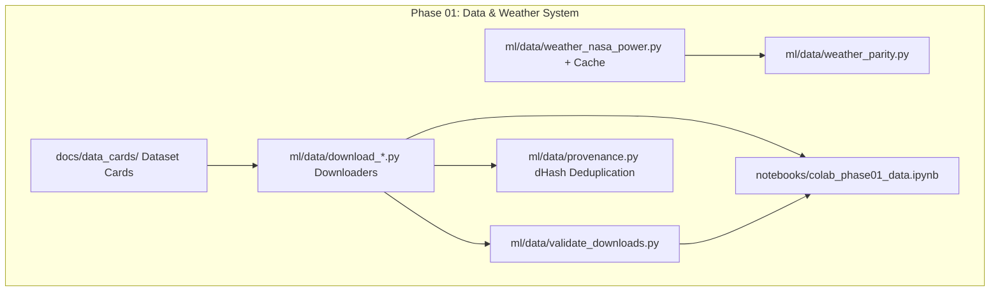

# Phase 01 Documentation: Data Audit, Downloaders & Weather Client

---

## 1. In One Sentence: What This Phase Does
Phase 01 audits all candidate plant disease and weather datasets, creates automated resumable downloaders, builds a disk-cached NASA POWER weather client, implements perceptual image deduplication tools, and provides a weather parity comparison framework for **crop-prognosis**.

---

## 2. Why This Step Exists (The Real-World Problem It Solves)
Machine learning models depend heavily on the quality, integrity, and legality of training data. In real-world data science projects:
- **Licensing & Legal Compliance**: Using datasets without verifying license terms exposes organizations to copyright infringement liability.
- **Corrupted Downloads**: Large file transfers across networks can drop bytes or corrupt files. SHA-256 checksums verify that downloaded data matches the author's original file.
- **Weather API Blocking**: Querying weather services repeatedly without disk caching wastes bandwidth and leads to API IP address blocks.
- **Forecast Misconceptions**: Historical weather APIs cannot predict future weather; disease forecasting requires structured scenario modeling.

Phase 01 solves these challenges by establishing rigorous data cards, secure download scripts, local weather response caching, deduplication tools, and scenario forecasting definitions.

---

## 3. Big-Picture Architecture Diagram

### Mermaid Diagram


### ASCII Diagram Fallback
```
+-----------------------------------------------------------------------+
|                PHASE 01: DATA AUDIT & WEATHER CLIENT                  |
+-----------------------------------------------------------------------+
  |
  +---> 1. Data Cards & Governance (docs/data_cards/, docs/data_governance.md)
  |
  +---> 2. Resumable Downloaders (ml/data/download_*.py)
  |
  +---> 3. NASA POWER Client (ml/data/weather_nasa_power.py with Disk Cache)
  |
  +---> 4. Weather Strategy & Presets (docs/weather_strategy.md)
  |
  +---> 5. Weather Parity Study (ml/data/weather_parity.py - ETH vs NASA)
  |
  +---> 6. Provenance & Deduplication (ml/data/provenance.py - dHash & Manifest)
  |
  v
+-----------------------------------------------------------------------+
|                    NEXT PHASE: VISION BACKBONE (PHASE 02)             |
+-----------------------------------------------------------------------+
```

---

## 4. Walkthrough of Every File Created

### Documentation Files
1. [`docs/data_cards/eth_wheat.md`](file:///c:/PlantDiseaseSeverity/docs/data_cards/eth_wheat.md): Data card detailing 12,520 ETH Zurich wheat leaf images, 1,032 time series, CC BY 4.0 license, and download policies.
2. [`docs/data_cards/plantseg.md`](file:///c:/PlantDiseaseSeverity/docs/data_cards/plantseg.md): Data card for 11,458 in-the-wild disease images across 34 plant species.
3. [`docs/data_cards/coffee_leaf_rust.md`](file:///c:/PlantDiseaseSeverity/docs/data_cards/coffee_leaf_rust.md): Data card for 1,285 coffee rust field photos and 606 lesion masks.
4. [`docs/data_cards/leafnet75.md`](file:///c:/PlantDiseaseSeverity/docs/data_cards/leafnet75.md): Data card for LeafNet75 SAM 2 leaf and lesion mask repositories.
5. [`docs/data_cards/plantvillage.md`](file:///c:/PlantDiseaseSeverity/docs/data_cards/plantvillage.md): Data card for PlantVillage lab photos (restricted to pretraining/sanity check).
6. [`docs/data_cards/leafnet.md`](file:///c:/PlantDiseaseSeverity/docs/data_cards/leafnet.md): Data card for LeafNet symptom text notes dataset.
7. [`docs/data_cards/nasa_power.md`](file:///c:/PlantDiseaseSeverity/docs/data_cards/nasa_power.md): Data card for NASA POWER Agroclimatology API.
8. [`docs/data_cards/zenodo_fungicide_trials.md`](file:///c:/PlantDiseaseSeverity/docs/data_cards/zenodo_fungicide_trials.md): Data card for 56 European wheat trials.
9. [`docs/weather_strategy.md`](file:///c:/PlantDiseaseSeverity/docs/weather_strategy.md): Explains why NASA POWER cannot forecast, defines 5 scenario presets, and details third-party forecast protocol stub.
10. [`docs/data_governance.md`](file:///c:/PlantDiseaseSeverity/docs/data_governance.md): Dataset license rules, attribution table, user photo privacy rules, and BibTeX citations.

### Python Code & Configuration Files
11. [`ml/configs/data.yaml`](file:///c:/PlantDiseaseSeverity/ml/configs/data.yaml): Configuration file for dataset paths, NASA POWER coordinates, and cache directories.
12. [`ml/data/download_eth_wheat.py`](file:///c:/PlantDiseaseSeverity/ml/data/download_eth_wheat.py): Downloader and structure validator for ETH wheat dataset checking author reported numbers.
13. [`ml/data/download_plantseg.py`](file:///c:/PlantDiseaseSeverity/ml/data/download_plantseg.py): Hugging Face / Zenodo downloader for PlantSeg.
14. [`ml/data/download_coffee_rust.py`](file:///c:/PlantDiseaseSeverity/ml/data/download_coffee_rust.py): Downloader for Coffee Leaf Rust dataset.
15. [`ml/data/download_leafnet_masks.py`](file:///c:/PlantDiseaseSeverity/ml/data/download_leafnet_masks.py): Downloader for LeafNet75 segmentation masks.
16. [`ml/data/download_plantvillage.py`](file:///c:/PlantDiseaseSeverity/ml/data/download_plantvillage.py): Optional downloader for PlantVillage.
17. [`ml/data/validate_downloads.py`](file:///c:/PlantDiseaseSeverity/ml/data/validate_downloads.py): Scans downloaded dataset directories and outputs JSON/Markdown summaries.
18. [`ml/data/weather_nasa_power.py`](file:///c:/PlantDiseaseSeverity/ml/data/weather_nasa_power.py): NASA POWER daily API client featuring local JSON caching, retries, and DataFrame conversion.
19. [`ml/data/weather_parity.py`](file:///c:/PlantDiseaseSeverity/ml/data/weather_parity.py): Aggregates ETH hourly weather data, compares against NASA POWER, and outputs scatter plots to `reports/figures/`.
20. [`ml/data/provenance.py`](file:///c:/PlantDiseaseSeverity/ml/data/provenance.py): Image dHash calculator, near-duplicate clustering tool, and Parquet manifest builder (`static_manifest.parquet`).
21. [`notebooks/colab_phase01_data.ipynb`](file:///c:/PlantDiseaseSeverity/notebooks/colab_phase01_data.ipynb): Google Colab execution notebook.

---

## 5. Worked Examples with Concrete Numbers

### Understanding Weather Concepts & Presets

- **Dataset License**: A legal agreement defining how a dataset can be used. For example, Creative Commons Attribution 4.0 (CC BY 4.0) allows commercial use and redistribution as long as original authors receive credit.
- **Checksum (SHA-256)**: A unique 64-character hash computed from a file's binary data (e.g. `e3b0c4...`). If even 1 bit changes, the checksum changes completely.
- **Weather Resolution**: NASA POWER provides weather data for ~50 km x 50 km grid squares. In hilly terrain, real microclimate temperatures on a farm can differ by 2°C to 4°C from grid averages.
- **Why Historical Services Cannot Forecast**: Historical services compile measurements after they happen. Predicting future days requires running physics simulations on supercomputers.

### Worked Example: Weather Scenario Presets (+3 Day Horizon)

*Note: The numbers in the table below are invented realistic values used for demonstration purposes.*

| Preset | Day 1 Temp (°C) | Day 1 RH (%) | Day 2 Temp (°C) | Day 2 RH (%) | Day 3 Temp (°C) | Day 3 RH (%) | Disease Risk Impact |
| :--- | :--- | :--- | :--- | :--- | :--- | :--- | :--- |
| **As Recent** | 18.5 | 82% | 19.0 | 85% | 17.8 | 80% | Moderate baseline growth |
| **Climatology** | 17.2 | 78% | 17.5 | 79% | 17.1 | 77% | Normal seasonal trend |
| **Warm & Humid** | 21.0 | 90% | 21.5 | 90% | 21.2 | 90% | **High risk** (Rapid spore growth) |
| **Cool & Dry** | 14.0 | 55% | 14.5 | 55% | 14.2 | 55% | **Low risk** (Suppressed growth) |

---

## 6. How to Run It: Local & Colab Execution

### Running Unit Tests Locally (CPU Only)
```bash
python -m pytest tests/ -v
```

### Running Downloader Dry-Runs
Verify download paths and file size estimates without transferring data:
```bash
python ml/data/download_eth_wheat.py --dry-run
python ml/data/download_plantseg.py --dry-run
```

### Testing NASA POWER Client (with Local Disk Caching)
```bash
python -c "
from ml.data.weather_nasa_power import fetch_nasa_power_daily
df = fetch_nasa_power_daily(47.449, 8.682, '20230501', '20230510')
print(df.head())
"
```

### Running the Documentation Validator
```bash
python scripts/check_docs.py
```

### Executing in Google Colab
1. Upload [`notebooks/colab_phase01_data.ipynb`](file:///c:/PlantDiseaseSeverity/notebooks/colab_phase01_data.ipynb) to Google Colab.
2. Mount Google Drive and set `DATA_ROOT = "/content/drive/MyDrive/crop_prognosis_data"`.
3. Execute all cells sequentially.

---

## 7. What You Should See: Expected Outputs

### Pytest Execution Output
```text
tests/test_config.py::test_load_default_config PASSED                    [  5%]
tests/test_downloaders.py::test_downloader_dry_runs PASSED               [ 20%]
tests/test_provenance.py::test_cluster_near_duplicates PASSED            [ 65%]
tests/test_validate_downloads.py::test_generate_validation_reports PASSED [ 90%]
tests/test_weather_nasa_power.py::test_fetch_nasa_power_daily_mocked PASSED [ 95%]

============================= 20 passed in 5.04s ==============================
```

### Generated Interim Reports
- `data/interim/download_validation.json`
- `data/interim/download_validation.md`
- `data/processed/static_manifest.parquet`

---

## 8. Common Errors and How to Fix Them

### Error 1: `NASAPowerError: HTTP status 429 / Service Unavailable`
- **Cause**: Repeated API requests without caching triggered temporary rate limits.
- **Fix**: Ensure `cache_dir` exists. Local cache automatically prevents re-querying fetched ranges.

### Error 2: `FileNotFoundError: RAW ETH dataset directory not found`
- **Cause**: Script was run before manually unzipping ETH wheat archives.
- **Fix**: Download `meta.zip` and `processed.zip` from ETH Research Collection and extract to `data/raw/eth_wheat/`.

### Error 3: `NameError: Optional is not defined`
- **Cause**: Missing `from typing import Optional` import.
- **Fix**: Import `Optional` and `Union` from `typing` module.

### Error 4: `ModuleNotFoundError: No module named 'datasets'`
- **Cause**: Hugging Face `datasets` library not installed in active environment.
- **Fix**: Run `pip install -r requirements-train.txt`.

### Error 5: `ValueError: ETH hourly weather DataFrame must contain timestamp`
- **Cause**: On-site weather CSV file missing standard timestamp headers.
- **Fix**: Ensure CSV contains columns named `timestamp` or `date`, `temperature`, and `rh`.

---

## 9. Self-Check Questions

1. **Question**: Why does the project avoid downloading raw ETH wheat images by default?
   - **Answer**: Raw 45-megapixel camera images exceed 100 GB; downloading metadata and processed masks first (~2–5 GB) saves bandwidth and local disk space.
2. **Question**: What license governs the ETH Zurich Wheat Leaf Time Series dataset?
   - **Answer**: Creative Commons Attribution 4.0 International (CC BY 4.0).
3. **Question**: Why can't NASA POWER provide future weather forecasts?
   - **Answer**: It is a historical reanalysis service compiled post-observation; it does not run numerical forward physics models.
4. **Question**: What spatial resolution does NASA POWER provide?
   - **Answer**: Approximately 0.5° x 0.625° (~50 km grid cell size).
5. **Question**: How does `ml/data/weather_nasa_power.py` prevent redundant API requests?
   - **Answer**: It hashes the location, dates, and parameters into a unique JSON cache file saved in `data/interim/weather_cache/`.
6. **Question**: What perceptual hashing algorithm is used for image deduplication?
   - **Answer**: Difference Hash (`dHash`) using horizontal pixel intensity gradients.
7. **Question**: What file format stores the deduplicated dataset manifest?
   - **Answer**: Apache Parquet format (`data/processed/static_manifest.parquet`).
8. **Question**: What is the privacy policy regarding user-uploaded leaf photos?
   - **Answer**: Processed in temporary memory, EXIF metadata stripped, never saved to disk by default.

---

## 10. Honest Limitations & What Could Go Wrong

1. **Weather Resolution Discrepancy**: NASA POWER's ~50 km grid resolution may smooth out microclimate temperature spikes on specific field plots.
2. **Hugging Face Authentication**: Some optional datasets (like `LeafNet`) may require logging in via `huggingface-cli login` if repository access policies change.
3. **Manual Download Dependency**: Due to ETH Research Collection portal design, full dataset archives require manual browser downloads.

---

## 11. Viva Questions & Model Answers

1. **Viva Question**: *What is perceptual hashing (dHash) and how does it differ from SHA-256?*
   - **Model Answer**: SHA-256 is an exact cryptographic hash where altering a single pixel changes the output completely. Perceptual hashing (dHash) captures visual structures; resized, compressed, or slightly altered versions of the same image produce near-identical hashes with small Hamming distances.
2. **Viva Question**: *Explain the five weather scenario presets used for disease forecasting.*
   - **Model Answer**: They are: (a) *As Recent* (repeats last 7 observed days), (b) *Climatology* (10-year historical average for same calendar days), (c) *Warm & Humid* (+3°C, 90% RH), (d) *Cool & Dry* (-3°C, 55% RH), and (e) *User-Entered* custom inputs.
3. **Viva Question**: *How do you validate that downloaded dataset files match author specifications?*
   - **Model Answer**: `ml/data/validate_downloads.py` recursively counts images, masks, and file sizes, checking against reported numbers (e.g., 12,520 images and 1,032 leaf time series for ETH wheat).
4. **Viva Question**: *Why is caching mandatory when requesting data from NASA POWER?*
   - **Model Answer**: NASA POWER servers block IP addresses that issue repeated identical queries. Caching stores responses locally in JSON format, ensuring fast offline execution and API compliance.
5. **Viva Question**: *What user photo privacy rules are implemented in the application?*
   - **Model Answer**: Photos are processed transiently in memory, EXIF location metadata is stripped, and photos are deleted after prediction unless the user explicitly opts in to contribute data.
6. **Viva Question**: *What is the difference between CORE and EXTENDED feature sets in the progression module?*
   - **Model Answer**: CORE features rely strictly on single photo inference and weather inputs available at prediction time. EXTENDED features include research-only attributes like cultivar resistance traits.

---

## 12. Definition of Done Checklist

- [x] Data cards created in `docs/data_cards/` for all candidate datasets with verification dates.
- [x] `docs/DATA_SOURCES.md` updated with links to data cards.
- [x] Resumable dataset downloaders written under `ml/data/` supporting `--dry-run`.
- [x] `ml/data/validate_downloads.py` created and tested.
- [x] NASA POWER weather client `ml/data/weather_nasa_power.py` created with disk caching and retries.
- [x] `docs/weather_strategy.md` written detailing 5 scenario presets and protocol stub.
- [x] Weather parity study script `ml/data/weather_parity.py` created.
- [x] Data provenance and perceptual hashing tool `ml/data/provenance.py` created.
- [x] Data governance framework `docs/data_governance.md` written.
- [x] Pipeline configuration `ml/configs/data.yaml` created.
- [x] Colab notebook `notebooks/colab_phase01_data.ipynb` written and validated.
- [x] All 20 unit tests in `tests/` passing on CPU.
- [x] Documentation rule validator `scripts/check_docs.py` passing for `docs/phase01_data_audit.md`.
