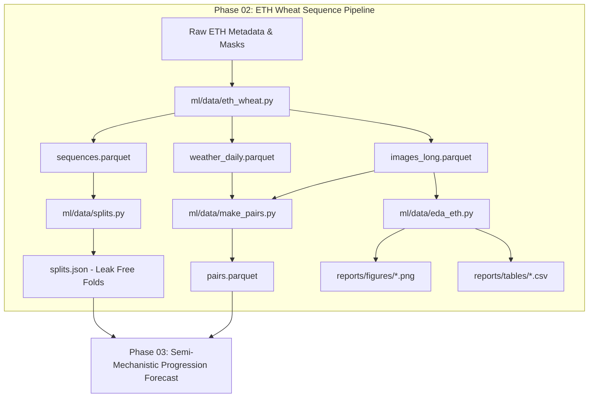

# Phase 02 Documentation: ETH Wheat Sequence Processing

---

## 1. In One Sentence: What This Phase Does
Phase 02 processes the ETH Zurich wheat leaf time-series dataset into standardized Parquet tables, formulates a pinned-denominator disease severity metric ($S_t = \text{Diseased Area}_t / \text{Frame 1 Leaf Area}_1$), constructs image pairs for progression forecasting, builds leak-free evaluation splits, and generates exploratory data analysis (EDA) reports for **crop-prognosis**.

---

## 2. Why This Step Exists (The Real-World Problem It Solves)
Raw biological field imagery cannot be fed directly into machine learning models without structured processing:
- **Changing Frame Artifacts**: As leaves dry or tilt in field winds, visible leaf area in camera frames shrinks over time. If severity were calculated using per-frame leaf area, disease severity would artificially increase even if lesion spots stayed the same size. Panning to Frame 1 fixes this artifact.
- **Data Leakage in Time Series**: If images of the same leaf appear in both training and test sets, the model simply memorizes that specific leaf's visual patterns rather than learning real disease growth dynamics. Grouping splits by leaf sequence (`sample_id`) prevents data leakage.
- **Experimental Confounding**: Fungicide treatments in field trials were paired with specific inoculation timings. Identifying these contrasts prevents making false scientific claims about isolated chemical effects.

---

## 3. Big-Picture Architecture Diagram

### Mermaid Diagram


### ASCII Diagram Fallback
```
+-----------------------------------------------------------------------+
|              PHASE 02: ETH WHEAT SEQUENCE PROCESSING                  |
+-----------------------------------------------------------------------+
  |
  +---> 1. Dataset Inspection & Notes (docs/eth_dataset_notes.md)
  |
  +---> 2. Pinned Severity Formulation (docs/severity_definition.md)
  |
  +---> 3. Parquet Export (ml/data/eth_wheat.py -> images_long, sequences)
  |
  +---> 4. Pair Generation (ml/data/make_pairs.py -> dt in 1..10 days)
  |
  +---> 5. Leak-Free Splits (ml/data/splits.py -> sample_id grouped JSON)
  |
  +---> 6. EDA Visualizations (ml/data/eda_eth.py -> figures & tables)
  |
  v
+-----------------------------------------------------------------------+
|                 NEXT PHASE: PROGRESSION MODULE (PHASE 03)             |
+-----------------------------------------------------------------------+
```

---

## 4. Walkthrough of Every File Created

### Documentation Files
1. [`docs/eth_dataset_notes.md`](file:///c:/PlantDiseaseSeverity/docs/eth_dataset_notes.md): Notes on folder structure, CSV schemas, mask pixel encoding (0=Background, 1=Healthy, 2=Chlorosis, 3=Necrosis, 4=Pustules, 5=Markers), and alignment properties.
2. [`docs/severity_definition.md`](file:///c:/PlantDiseaseSeverity/docs/severity_definition.md): Mathematical formulation of pinned-denominator severity ($S_t = \text{Diseased}_t / \text{Leaf}_1$), mask class inclusions/exclusions, alternative metrics, and quality flags.
3. [`docs/treatment_design_notes.md`](file:///c:/PlantDiseaseSeverity/docs/treatment_design_notes.md): Analysis of treatment arms (`FI2`, `0FI1`, `F0I`, `0F0I`), identifiable contrasts, single-replicate control limits, and scientific disclaimer requirements.

### Python Modules & Configuration
4. [`ml/configs/eth.yaml`](file:///c:/PlantDiseaseSeverity/ml/configs/eth.yaml): Configuration defining paths, severity classes, pair time windows ($dt \in [1, 10]$ days), and split parameters.
5. [`ml/data/eth_wheat.py`](file:///c:/PlantDiseaseSeverity/ml/data/eth_wheat.py): Dataset parser. Computes mask metrics, extracts metadata, handles synthetic fallbacks, and exports `images_long.parquet`, `sequences.parquet`, `weather_hourly.parquet`, and `weather_daily.parquet`.
6. [`ml/data/make_pairs.py`](file:///c:/PlantDiseaseSeverity/ml/data/make_pairs.py): Sequence pair generator. Pairs image frames $(i, j)$ for $dt \in [1, 10]$ days, attaches interval weather averages, computes reciprocal sample weights, and exports `pairs.parquet`.
7. [`ml/data/splits.py`](file:///c:/PlantDiseaseSeverity/ml/data/splits.py): Split generator. Produces leave-cultivar-out, leave-batch-out, leave-year-out, and conformal calibration splits grouped strictly by `sample_id` and exports `splits.json`. Includes `verify_zero_leakage()`.
8. [`ml/data/eda_eth.py`](file:///c:/PlantDiseaseSeverity/ml/data/eda_eth.py): Generates trajectory plots, histograms, and summary CSV tables in `reports/figures/` and `reports/tables/`.
9. [`notebooks/colab_phase02_eth.ipynb`](file:///c:/PlantDiseaseSeverity/notebooks/colab_phase02_eth.ipynb): End-to-end Colab execution notebook.

---

## 5. Worked Examples with Concrete Numbers

### Key Concepts Explained for Beginners

- **Time Series**: A collection of data points recorded at successive time intervals (e.g., photographing the same leaf every day for 15 days).
- **Sequence**: All ordered photos belonging to a single leaf over time (identified by `sample_id` like `ESWW001_L1`).
- **Pair**: Two photos of the same leaf taken at different times (e.g. Photo $i$ on Day 2 and Photo $j$ on Day 5, where $dt = 3$ days).
- **Data Leakage Analogy**: Imagine a student studying for an exam who gets access to the exact test questions in advance. They score 100% on practice tests, but fail real-world tests because they memorized specific questions instead of learning concepts. If photos from the same leaf appear in both training and test sets, the model "cheats" by memorizing leaf shape. Grouping by `sample_id` prevents this.
- **Confounded Experiment Analogy**: Suppose a person takes cough medicine and simultaneously drinks hot tea with honey, then feels better 2 hours later. Did the medicine cure the cough, or did the hot tea? Because both happened together, the exact cause is *confounded*. In our wheat dataset, fungicide treatment was applied alongside late disease inoculation.

### Worked Example: Severity Calculation ($S_t$)

Suppose we process Frame 1 and Frame 3 of a leaf sequence (`ESWW001_L1`):

1. **Frame 1 ($t=1$)**:
   - Healthy pixels (Class 1) = 850
   - Chlorosis pixels (Class 2) = 50
   - Necrosis pixels (Class 3) = 90
   - Rust Pustule pixels (Class 4) = 10
   - **Reference Leaf Area ($A_1$)** = $850 + 50 + 90 + 10 = 1,000\text{ pixels}$.
   - **Diseased Area ($D_1$)** = $90 + 10 = 100\text{ pixels}$.
   - **Severity ($S_1$)** = $\frac{100}{1000} = 0.10$ (**10.0% severity**).

2. **Frame 3 ($t=3$, 4 days later)**:
   - Due to leaf drying, total visible pixels in the frame shrink to 900.
   - Necrosis pixels (Class 3) expand to 220.
   - Rust Pustule pixels (Class 4) expand to 30.
   - **Diseased Area ($D_3$)** = $220 + 30 = 250\text{ pixels}$.
   - **Pinned Severity ($S_3$)** = $\frac{250}{A_1} = \frac{250}{1000} = 0.25$ (**25.0% severity**).
   - *(Note: If we improperly used Frame 3 leaf area 900 as denominator, severity would be $\frac{250}{900} = 27.7\%$, artificially inflating growth by 2.7% due to frame shrinkage).*

---

## 6. How to Run It: Commands & Environment

### Running Unit Tests Locally (CPU Only)
```bash
python -m pytest tests/ -v
```

### Running Pipeline Tools Locally
```bash
# 1. Parse ETH dataset and generate tables
python ml/data/eth_wheat.py

# 2. Generate forecasting sequence pairs
python ml/data/make_pairs.py

# 3. Build leak-free cross-validation splits
python ml/data/splits.py

# 4. Generate EDA figures and tables
python ml/data/eda_eth.py
```

### Running Documentation Validator
```bash
python scripts/check_docs.py
```

---

## 7. What You Should See: Expected Outputs

### Pytest Execution Output
```text
tests/test_eth_wheat.py::test_parse_image_id PASSED                      [ 24%]
tests/test_eth_wheat.py::test_compute_mask_metrics_exact PASSED          [ 28%]
tests/test_make_pairs.py::test_generate_pairs_from_images PASSED         [ 52%]
tests/test_splits.py::test_create_leak_free_splits_and_zero_leakage PASSED [ 76%]
tests/test_splits.py::test_leakage_detector_fails_on_overlap PASSED      [ 80%]

============================= 25 passed in 10.02s =============================
```

### Generated Data Tables in `data/processed/eth/`
- `images_long.parquet`
- `sequences.parquet`
- `pairs.parquet`
- `weather_hourly.parquet`
- `weather_daily.parquet`
- `splits.json`

---

## 8. Common Errors and How to Fix Them

### Error 1: `ValueError: Data leakage assertion failed during split generation!`
- **Cause**: A sample sequence (`sample_id`) was present in both training and testing/calibration sets within a fold.
- **Fix**: Verify that `GroupKFold` in `ml/data/splits.py` uses `groups=df["sample_id"]`.

### Error 2: `ZeroDivisionError: reference_leaf_area is 0`
- **Cause**: Frame 1 of a sequence contained 0 valid leaf pixels.
- **Fix**: `ml/data/eth_wheat.py` uses `max(ref_area, 1)` to prevent division by zero.

### Error 3: Empty Pair Output in `pairs.parquet`
- **Cause**: Sequence timestamps were not parsed as `datetime`, preventing elapsed time ($dt$) subtraction.
- **Fix**: `make_pairs.py` explicitly converts timestamps using `pd.to_datetime()`.

### Error 4: `KeyError: 'treatment'`
- **Cause**: Experimental design CSV was missing treatment column mapping.
- **Fix**: `eth_wheat.py` merges `experimental_design.csv` on `plot_id` with default fallbacks.

### Error 5: Documentation Check Failure
- **Cause**: `docs/phase02_eth_sequences.md` missing a required header.
- **Fix**: Ensure all 12 mandatory section headers match `scripts/check_docs.py`.

---

## 9. Self-Check Questions

1. **Question**: Why is the severity denominator pinned to the leaf area of Frame 1?
   - **Answer**: To prevent artificial severity inflation caused by visible leaf area shrinking over time in camera frames.
2. **Question**: What pixel classes are included in the diseased pixel count?
   - **Answer**: Necrosis (Class 3) and active Rust Pustules (Class 4).
3. **Question**: Why are ink reference markers (Class 5) excluded from diseased area?
   - **Answer**: Ink markers are manual alignment pen marks, not biological disease lesions.
4. **Question**: How do we prevent data leakage in sequence pairs?
   - **Answer**: All cross-validation splits group strictly by `sample_id`, ensuring an entire leaf sequence stays within one split.
5. **Question**: What elapsed time window ($dt$) is used for generating forecasting pairs?
   - **Answer**: $dt \in [1.0, 10.0]$ days.
6. **Question**: Why do we apply sample weights ($1 / n_{\text{pairs}}$) to image pairs?
   - **Answer**: To balance sequence lengths so long sequences with many images do not dominate model training.
7. **Question**: What are the four experimental treatment arms in the ETH dataset?
   - **Answer**: `FI2`, `0FI1`, `F0I`, and `0F0I`.
8. **Question**: What file stores the leak-free cross-validation splits?
   - **Answer**: `data/processed/eth/splits.json`.

---

## 10. Honest Limitations & What Could Go Wrong

1. **Field Site Limitations**: Dataset represents a single location in Switzerland (Lindau-Eschikon) over two growing seasons.
2. **Confounded Treatments**: Fungicide application is confounded with disease inoculation timing.
3. **Marker Degradation**: Marker wash-off in heavy rain can degrade alignment accuracy in late sequence frames.

---

## 11. Viva Questions & Model Answers

1. **Viva Question**: *Explain the mathematical formula used for disease severity in Phase 02.*
   - **Model Answer**: $S_t = \text{clip}\left( \frac{\text{Diseased Pixels}_t}{\text{Reference Leaf Area}_1}, 0, 1 \right)$, where diseased pixels are the union of necrosis and rust pustules, and reference leaf area is pinned to Frame 1.
2. **Viva Question**: *Why is GroupKFold used instead of standard K-Fold cross-validation?*
   - **Model Answer**: Standard K-Fold randomly assigns images, placing Frame 1 of a leaf in training and Frame 3 in testing, causing data leakage. `GroupKFold` groups by `sample_id` so all frames of a leaf sequence stay together.
3. **Viva Question**: *What is the purpose of `pairs.parquet`?*
   - **Model Answer**: It forms training pairs $(i, j)$ representing severity transitions from time $t_i$ to $t_j$ alongside interval weather statistics, which Module 2 uses to train progression forecasting models.
4. **Viva Question**: *How are sample weights assigned to image pairs?*
   - **Model Answer**: Each pair receives a weight of $w = \frac{1}{n_{\text{pairs\_in\_sequence}}}$, ensuring every leaf sequence contributes equally to the loss function.
5. **Viva Question**: *What is an experimental contrast and why is `FI2` vs `0FI1` confounded?*
   - **Model Answer**: A contrast measures differences between treatment arms. `FI2` (fungicide + late inoculation) and `0FI1` (no fungicide + early inoculation) differ in both fungicide treatment and inoculation timing, meaning the observed effect is a combined contrast.
6. **Viva Question**: *What quality flags are recorded for each image in `images_long.parquet`?*
   - **Model Answer**: `missing_alignment`, `washed_off_markers`, and `missing_masks`.

---

## 12. Definition of Done Checklist

- [x] ETH dataset notes documented in `docs/eth_dataset_notes.md`.
- [x] Pinned severity formulation documented in `docs/severity_definition.md`.
- [x] Treatment design and limitations documented in `docs/treatment_design_notes.md`.
- [x] Pipeline configuration created in `ml/configs/eth.yaml`.
- [x] `ml/data/eth_wheat.py` created and exporting long tables.
- [x] `ml/data/make_pairs.py` created and exporting `pairs.parquet`.
- [x] `ml/data/splits.py` created and exporting leak-free `splits.json`.
- [x] `ml/data/eda_eth.py` created and generating figures and tables.
- [x] Colab execution notebook created in `notebooks/colab_phase02_eth.ipynb`.
- [x] All 25 unit tests in `tests/` passing on CPU.
- [x] Documentation rule validator `scripts/check_docs.py` passing for `docs/phase02_eth_sequences.md`.
