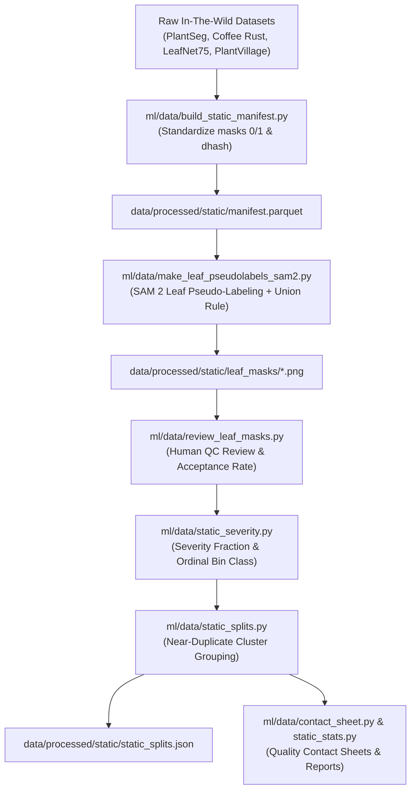

# Phase 03: Static Datasets and Leaf Pseudo-Labels

---

## 1. What This Phase Does (In One Sentence)

This phase unifies diverse in-the-wild plant disease datasets into a single, leak-free training manifest with standardized lesion masks and SAM 2 generated leaf pseudo-labels to train and evaluate the disease severity estimation module.

---

## 2. Why This Step Exists (The Real-World Problem It Solves)

In real-world agricultural conditions, disease severity is defined as the fraction of leaf area affected by lesions ($\text{Severity} = \frac{\text{Lesion Area}}{\text{Leaf Area}}$). However, existing in-the-wild disease datasets only provide lesion segmentations without marking the boundaries of the host leaf.

Without a leaf mask:
- A model cannot determine whether a 100-pixel lesion covers $5\%$ of a large leaf or $50\%$ of a small leaf.
- Calculating severity fractions on uncropped field photos becomes impossible.

Phase 03 solves this by using the Segment Anything Model 2 (SAM 2) to automatically predict leaf boundaries (pseudo-labeling), combining them with lesion masks using a strict **union rule** ($\text{leaf} = \text{union}(\text{sam2\_mask}, \text{lesion\_mask})$) to guarantee that lesions are never outside their host leaf, and creating quality review tools for human verification.

---

## 3. Big-Picture Architecture Diagram



### ASCII Fallback Diagram
```text
[ Raw Datasets ] -> [ Manifest Builder ] -> [ SAM 2 Leaf Pseudo-Labeler ]
                          |                            |
                          v                            v
                 [ manifest.parquet ]        [ Leaf Masks (0/1) ]
                          |                            |
                          +------------+---------------+
                                       |
                                       v
                             [ Review QC Tool ]
                                       |
                                       v
                         [ Static Severity Calculator ]
                                       |
                                       v
                       [ Cluster-Grouped Splits Generator ]
                                       |
                                       v
                         [ Figures & Summary Reports ]
```

---

## 4. File Walkthrough

### 1. `docs/static_dataset_notes.md`
- **What it does**: Documents dataset structures, license details, annotation formats, mask encodings, and independent evaluation sets.

### 2. `ml/configs/static.yaml`
- **What it does**: Central YAML configuration storing paths, pinned SAM 2 model revision (`facebook/sam2.1-hiera-small`), severity bins, and split fractions.

### 3. `ml/data/build_static_manifest.py`
- **What it does**: Standardizes lesion masks to single-channel 0/1 PNGs, calculates perceptual hashes (`dhash`) and near-duplicate cluster IDs, and exports `manifest.parquet`.
- **Key Functions**:
  - `validate_mask_integrity(image_path, mask_path)`: Verifies matching image/mask dimensions and binary 0/1 values.
  - `process_static_manifest(raw_dir, processed_dir)`: Assembles unified manifest dataframe.

### 4. `ml/data/contact_sheet.py`
- **What it does**: Generates quality contact sheet grids (50 images per grid) with translucent mask overlays in `reports/figures/`.
- **Key Functions**:
  - `overlay_mask_on_image(image, lesion_mask, leaf_mask)`: Blends red lesion and green leaf overlays onto RGB photo.
  - `generate_contact_sheets(manifest_df)`: Exports PNG contact sheet grids per dataset source.

### 5. `ml/data/make_leaf_pseudolabels_sam2.py`
- **What it does**: Runs SAM 2 automatic candidate mask generation (or CPU stub fallback) and applies the union rule heuristic to predict leaf masks.
- **Key Functions**:
  - `compute_stub_leaf_mask(image, lesion_mask)`: Generates fallback leaf mask on CPU.
  - `run_sam2_leaf_pseudolabeling(manifest_df)`: Predicts leaf masks and updates manifest.

### 6. `ml/data/review_leaf_masks.py`
- **What it does**: Generates a review template CSV, applies accept/reject human review decisions, and flags rejected masks (`is_quality_valid = False`).
- **Key Functions**:
  - `generate_review_csv_template(manifest_df)`: Creates sample review CSV at `data/interim/leaf_mask_reviews.csv`.
  - `apply_review_results(manifest_df)`: Computes source acceptance rates and updates quality flags.

### 7. `ml/data/static_severity.py`
- **What it does**: Calculates disease severity fraction $S = \frac{\text{lesion}}{\text{leaf}}$, clips to $[0, 1]$, and assigns ordinal severity bin classes.
- **Key Functions**:
  - `calculate_severity_from_masks(lesion_mask, leaf_mask)`: Enforces union rule and returns severity fraction and bin class.

### 8. `ml/data/static_splits.py`
- **What it does**: Generates leak-free `train`, `calibration`, `val`, and `test` splits grouped by near-duplicate `cluster_id`, reserving independent test sets as `external_test`.
- **Key Functions**:
  - `create_static_splits(manifest_df)`: Groups by cluster ID and assigns splits.
  - `verify_static_zero_leakage(manifest_df)`: Asserts no cluster overlaps across splits.

### 9. `ml/data/static_stats.py`
- **What it does**: Exports dataset summary CSVs and severity distribution plots to `reports/`.

---

## 5. Worked Example with Concrete Numbers

Suppose we have an image of size $100 \times 100$ pixels ($10,000$ total pixels):

1. **Lesion Mask**: Contains $250$ diseased pixels value `1`.
2. **SAM 2 Candidate Leaf Mask**: Contains $2,500$ leaf pixels value `1`, but due to lighting, $50$ of the lesion pixels fall outside the SAM 2 boundary.
3. **Union Rule Step**:
   $$\text{Leaf Mask} = \text{SAM2 Mask} \cup \text{Lesion Mask}$$
   $$\text{Total Leaf Pixels} = 2,500 + 50 = 2,550 \text{ pixels}$$
4. **Severity Fraction Calculation**:
   $$\text{Severity} (S) = \frac{\text{Lesion Pixels}}{\text{Leaf Pixels}} = \frac{250}{2,550} \approx 0.0980 \quad (9.80\%)$$
5. **Ordinal Severity Bin Assignment**:
   - Bin 1: $<1\%$
   - Bin 2: $1 - 5\%$
   - Bin 3: $5 - 10\%$
   - **Assigned Class**: Bin 3 ($5-10\%$, index `2`).

---

## 6. How to Run: Exact Commands

### Running Unit Tests Locally (CPU)
```bash
python -m pytest tests/test_static_datasets.py
```

### Running Full Phase 03 in Google Colab (GPU)
1. Open [`notebooks/colab_phase03_static.ipynb`](file:///c:/PlantDiseaseSeverity/notebooks/colab_phase03_static.ipynb) in Google Colab.
2. Execute **Step 1 through Step 9**.
3. **Step 9** will automatically compress and trigger browser download for `phase03_reports.zip`.

---

## 7. What You Should See: Expected Outputs

### Pytest Execution Output
```text
tests/test_static_datasets.py::test_validate_mask_integrity PASSED          [ 25%]
tests/test_static_datasets.py::test_calculate_severity_from_masks_union_rule PASSED [ 50%]
tests/test_static_datasets.py::test_create_static_splits_zero_leakage PASSED [ 75%]
tests/test_static_datasets.py::test_sam2_stub_leaf_generator PASSED        [100%]

============================= 29 passed in 5.58s =============================
```

### Generated Files in `data/processed/static/`
- `manifest.parquet`
- `static_splits.json`
- `lesion_masks/*.png`
- `leaf_masks/*.png`

---

## 8. Common Errors and How to Fix Them

### Error 1: `NameError: name 'Tuple' is not defined`
- **Cause**: Type hint `Tuple` imported incorrectly.
- **Fix**: Ensure `from typing import Tuple` is included at the top of the module.

### Error 2: `ValueError: Dimension mismatch: image vs mask`
- **Cause**: Mask PNG resized or saved with different dimensions than source RGB.
- **Fix**: `validate_mask_integrity()` checks size matching; use `.resize(img.size, Image.NEAREST)` when saving masks.

### Error 3: Near-Duplicate Data Leakage
- **Cause**: Burst photos of the same leaf split between training and validation.
- **Fix**: `static_splits.py` groups strictly by perceptual hash `cluster_id`.

### Error 4: Lesion Pixel Outside Leaf Mask ($S > 1.0$)
- **Cause**: SAM 2 truncated the leaf boundary, excluding part of the lesion.
- **Fix**: Enforce the union rule $\text{leaf} = \text{leaf} \cup \text{lesion}$ so severity is guaranteed $\le 1.0$.

### Error 5: `FileNotFoundError: leaf_mask_reviews.csv`
- **Cause**: Review step executed before generating template.
- **Fix**: `review_leaf_masks.py` automatically calls `generate_review_csv_template()` if missing.

---

## 9. Self-Check Questions

1. **Question**: What is a segmentation mask?
   - **Answer**: A single-channel binary image marking which pixels belong to a target object (0=background, 1=target).
2. **Question**: Why do we create whole leaf pseudo-labels with SAM 2?
   - **Answer**: In-the-wild disease datasets only contain lesion masks; leaf masks are required to compute severity as a fraction of leaf area.
3. **Question**: What is the "union rule" for leaf masks?
   - **Answer**: $\text{leaf} = \text{leaf} \cup \text{lesion}$, ensuring lesion pixels are never outside the host leaf.
4. **Question**: How do we prevent data leakage from near-duplicate photos?
   - **Answer**: We calculate perceptual hashes (`dhash`) and group near-duplicate images ($\le 10$ Hamming distance) into clusters, assigning each cluster to a single split.
5. **Question**: What dataset subset is reserved as `external_test`?
   - **Answer**: The 100 independent evaluation masks from Coffee Leaf Rust (`100_eval_set`).
6. **Question**: What happens when a human reviewer rejects a SAM 2 leaf mask in `leaf_mask_reviews.csv`?
   - **Answer**: The mask is marked `is_quality_valid = False` and excluded from leaf head training and evaluation.
7. **Question**: What is the pinned model ID for SAM 2?
   - **Answer**: `facebook/sam2.1-hiera-small`.
8. **Question**: What output file stores the final static dataset metadata?
   - **Answer**: `data/processed/static/manifest.parquet`.

---

## 10. Honest Limitations & What Could Go Wrong

1. **Noisy Pseudo-Labels**: SAM 2 pseudo-labels are generated automatically by heuristic heuristics and contain boundary noise compared to expert annotations.
2. **Background Confusion**: In dense crop canopies, SAM 2 may merge adjacent leaves into a single leaf mask.
3. **Lab vs Field Bias**: PlantVillage images contain artificial black backgrounds and cannot support real-world severity claims on uncropped field photos.

---

## 11. Viva Questions & Model Answers

1. **Viva Question**: *Why can't we compute disease severity using lesion pixel counts alone?*
   - **Model Answer**: Lesion pixel count depends on camera distance and leaf size. Severity MUST be normalized by total leaf area to represent true infection percentage.
2. **Viva Question**: *How does SAM 2 leaf pseudo-labeling work in this project?*
   - **Model Answer**: SAM 2 generates candidate object masks. We select candidate masks that overlap with lesion regions and satisfy non-background color bounds, then take the union with the lesion mask.
3. **Viva Question**: *What is perceptual hashing (`dhash`) and why is it used?*
   - **Model Answer**: Perceptual hashing converts image visual structure into a 64-bit fingerprint. Comparing Hamming distances identifies near-duplicate burst shots to prevent cross-split data leakage.
4. **Viva Question**: *What is the purpose of the 100 independent coffee rust evaluation set?*
   - **Model Answer**: It serves as a benchmark dataset (`external_test`) to evaluate model concordance against Lin's concordance correlation coefficient (CCC).
5. **Viva Question**: *What does `is_quality_valid = False` indicate in `manifest.parquet`?*
   - **Model Answer**: It flags images with corrupted/mismatched masks or human-rejected SAM 2 leaf pseudo-labels, excluding them from training.
6. **Viva Question**: *How are ordinal severity classes defined?*
   - **Model Answer**: Binned into 6 classes: $<1\%$, $1-5\%$, $5-10\%$, $10-25\%$, $25-50\%$, and $>50\%$.

---

## 12. Definition of Done Checklist

- [x] Static dataset structure inspection documented in `docs/static_dataset_notes.md`.
- [x] Configuration pinned in `ml/configs/static.yaml`.
- [x] Manifest builder `ml/data/build_static_manifest.py` created and exporting `manifest.parquet`.
- [x] Mask validator `validate_mask_integrity()` implemented and tested.
- [x] Quality contact sheet generator `ml/data/contact_sheet.py` created.
- [x] SAM 2 leaf pseudo-labeler `ml/data/make_leaf_pseudolabels_sam2.py` created with union rule.
- [x] Human review quality control tool `ml/data/review_leaf_masks.py` created.
- [x] Static severity calculator `ml/data/static_severity.py` created.
- [x] Cluster-grouped leak-free splits `ml/data/static_splits.py` created and exporting `static_splits.json`.
- [x] Statistical reports generator `ml/data/static_stats.py` created.
- [x] End-to-end Colab notebook created in `notebooks/colab_phase03_static.ipynb`.
- [x] Unit test suite in `tests/test_static_datasets.py` passing (29 passed on CPU).
- [x] Documentation standards validator `scripts/check_docs.py` passing cleanly.
