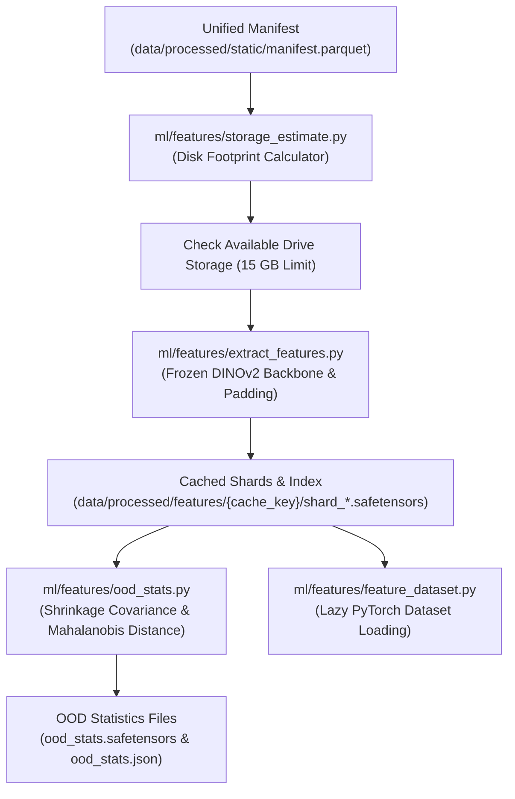

# Phase 04: Vision Backbone Feature Extraction and Caching

---

## 1. What This Phase Does (In One Sentence)

This phase runs a pre-trained, frozen DINOv2 vision backbone over all training images once on a GPU to extract visual feature embeddings, caches them to disk in secure `.safetensors` format, and computes shrinkage-regularized Out-of-Distribution (OOD) distance statistics for downstream model training and real-time safety validation.

---

## 2. Why This Step Exists (The Real-World Problem It Solves)

In computer vision applications for crop disease diagnosis:
- **Computational Bottleneck**: Deep vision backbones (like DINOv2 with 21M to 86M parameters) take significant compute time and memory to process raw RGB images. Passing thousands of high-resolution images through a vision backbone on every single training epoch would take hours and require expensive GPUs.
- **Resource Constraints**: The developer local machine has no GPU, and free Google Colab GPU sessions have strict time limits.
- **Security & Safety Requirements**: Legacy Python pickling (`.pkl`) introduces critical remote code execution security vulnerabilities, while real-time user image safety checks require mathematical boundaries to detect out-of-distribution photos (like photos of shoes, cars, or random non-leaf objects).

Phase 04 solves these problems by:
1. **Caching Features Once**: Running the heavy vision backbone *once* on a GPU, extracting mathematical summary vectors ("features"), and saving them to disk. Future head training runs 50x faster and can execute even on a basic CPU.
2. **Secure Sharded Storage**: Storing feature tensors in zero-pickle `.safetensors` files with cryptographic cache-key validation.
3. **Out-of-Distribution (OOD) Statistics**: Calculating shrinkage covariance matrices and Mahalanobis distance thresholds to detect non-leaf or corrupted inputs during app serving.

---

## 3. Big-Picture Architecture Diagram



### ASCII Fallback Diagram
```text
[ Manifest parquet ] -> [ Storage Footprint Estimator ] -> [ Check 15 GB Limit ]
                                                                |
                                                                v
                                                   [ Frozen DINOv2 Extractor ]
                                                                |
                                                                v
                                                   [ Sharded .safetensors & index.json ]
                                                                |
                                        +-----------------------+-----------------------+
                                        |                                               |
                                        v                                               v
                          [ OOD Statistics Calculator ]                     [ Lazy PyTorch Dataset ]
                                        |                                               |
                                        v                                               v
                       [ ood_stats.safetensors & JSON ]               [ Downstream Head Training ]
```

---

## 4. Walkthrough of Every File Created

### 1. `ml/configs/features.yaml`
- **What it does**: Centralized YAML configuration for DINOv2 backbone IDs (`facebook/dinov2-small`, `facebook/dinov2-base`), pinned revision tags (`main`), patch resolution (14x14 pixels), spatial resolutions (`[448, 672, 896]`), mixed-precision float16 extraction settings, ETH macro image handling mode (`downscaled_crop`), and OOD shrinkage parameter ($\gamma = 0.01$).

### 2. `ml/features/storage_estimate.py`
- **What it does**: Calculates exact disk storage requirements before extraction begins, ensuring feature caches do not exceed free Google Drive quotas (15 GB).
- **Key Functions**:
  - `calculate_image_feature_size(resolution, patch_size, embed_dim)`: Calculates grid dimensions and exact byte footprint per image.
  - `estimate_storage_for_dataset(n_images, backbone_name, resolution)`: Estimates total megabytes (MB) and gigabytes (GB) for a given dataset size.
  - `generate_storage_report(static_n, eth_n, available_gb)`: Builds a comparison matrix across backbones and resolutions, raising safety warnings if Drive limits are exceeded.

### 3. `ml/features/extract_features.py`
- **What it does**: Loads the frozen DINOv2 vision backbone, resizes and pads images to exact multiples of patch size (14), extracts CLS tokens, mean patch tokens, and patch token grids, and exports sharded `.safetensors` files.
- **Key Functions**:
  - `compute_cache_key(backbone_id, revision, resolution, patch_size, eth_mode)`: Computes a 16-character SHA-256 hash key representing the exact extraction configuration. Refuses to mix caches if settings change.
  - `preprocess_image(image, target_resolution, patch_size)`: Resizes an image preserving aspect ratio and pads height/width to multiples of 14.
  - `extract_image_tiles(image, tile_size, tile_overlap)`: Extracts sliding-window tiles from high-resolution macro photos (ETH dataset).
  - `FeatureExtractorEngine`: Class that manages backbone loading (supports PyTorch GPU models and CPU stub models for testing).
  - `run_feature_extraction_pipeline(...)`: End-to-end extraction runner with resumable execution (skips already processed images).

### 4. `ml/features/ood_stats.py`
- **What it does**: Computes per-source mean vectors, shrinkage-regularized covariance matrices, precision matrices, and validation Mahalanobis distance percentiles for out-of-distribution safety checks.
- **Key Functions**:
  - `compute_mahalanobis_distance(x, mean_vec, precision_matrix)`: Calculates scalar Mahalanobis distance $D_M(x) = \sqrt{(x - \mathbf{\mu})^T \mathbf{\Sigma}^{-1} (x - \mathbf{\mu})}$.
  - `compute_ood_statistics(train_features, val_features, gamma)`: Applies Ledoit-Wolf-style shrinkage regularization ($\mathbf{\Sigma} = (1 - \gamma)\mathbf{S} + \gamma \nu \mathbf{I}$) and calculates 95th and 99th percentile validation bounds.
  - `process_ood_stats(cache_dir, output_dir)`: Loads CLS embeddings from cached shards and exports `ood_stats.safetensors` and `ood_stats.json`.

### 5. `ml/features/feature_dataset.py`
- **What it does**: A PyTorch `Dataset` class that lazily loads feature tensors from sharded `.safetensors` files on demand, resizing ground truth lesion and leaf masks to match the patch grid.
- **Key Class**:
  - `CachedFeatureDataset`: Implements `__len__` and `__getitem__` with an in-memory shard cache to avoid repeated disk reads.

### 6. `tests/test_features.py`
- **What it does**: CPU-compatible test suite verifying storage estimation, padding arithmetic, cache-key hashing, mismatch refusal, resumption, ETH macro tiling, OOD covariance shrinkage, and zero-pickle security rules.

### 7. `notebooks/colab_phase04_features.ipynb`
- **What it does**: Standalone 8-cell Google Colab notebook for GPU feature extraction, storage estimation, OOD calculation, and result packaging.

---

## 5. Worked Example with Concrete Numbers

### Conceptual Analogies for Beginners

1. **Vision Backbone = Experienced Plant Inspector**:
   Think of a vision backbone as an expert agricultural inspector. When shown a leaf photo, the inspector doesn't re-learn what a leaf is every time; instead, they inspect the photo and write down a precise list of numbers describing color, spot textures, and leaf shapes.

2. **Frozen Weights = Locked Inspection Standards**:
   "Frozen" means we lock the inspector's memory. We do not change how the inspector sees the world; we only train small helper models ("heads") to interpret the inspector's written notes.

3. **Patch Tokens = Floor Tiles**:
   A Vision Transformer divides a photo into a grid of small square tiles (like floor tiles of 14x14 pixels). Each tile gets its own dedicated list of numbers (a "patch token") describing what is inside that specific square.

4. **Feature Caching = Cooking Rice Once**:
   Imagine cooking a large pot of rice once and storing it in the refrigerator. Instead of boiling raw rice from scratch for every meal, you simply scoop out what you need. Caching features extracts vision representations *once* so downstream training takes seconds instead of hours.

---

### Worked Math Example 1: Spatial Grid Dimensions & Feature Memory Footprint

Suppose we process a photo at **$448 \times 448$ resolution** using **DINOv2-Small** (patch size $14 \times 14$, embedding dimension $D = 384$, stored in `float16` precision at 2 bytes per float).

1. **Calculate Patch Grid Shape**:
   $$\text{Grid Height } (g_h) = \frac{448}{14} = 32 \text{ patches}$$
   $$\text{Grid Width } (g_w) = \frac{448}{14} = 32 \text{ patches}$$
   $$\text{Total Patches } (N) = 32 \times 32 = 1,024 \text{ patch tokens}$$

2. **Calculate Byte Footprint Per Image**:
   - **`[CLS]` Token**: $1 \text{ vector} \times 384 \text{ floats} \times 2 \text{ bytes} = 768 \text{ bytes}$
   - **Mean Patch Token**: $1 \text{ vector} \times 384 \text{ floats} \times 2 \text{ bytes} = 768 \text{ bytes}$
   - **Patch Grid Tokens**: $1,024 \text{ vectors} \times 384 \text{ floats} \times 2 \text{ bytes} = 786,432 \text{ bytes}$
   - **Metadata & Index Overhead**: $\approx 500 \text{ bytes}$

   $$\text{Total Footprint Per Image} = 768 + 768 + 786,432 + 500 = 788,468 \text{ bytes} \approx 0.7519 \text{ MB}$$

3. **Calculate Total Cache Footprint for 13,520 Images**:
   $$\text{Total Storage} = 13,520 \text{ images} \times 0.7519 \text{ MB/image} = 10,165.7 \text{ MB} \approx 9.93 \text{ GB}$$

   Since $9.93 \text{ GB} \le 15.0 \text{ GB}$, DINOv2-Small at $448 \times 448$ fits safely inside free Google Drive storage!

---

### Worked Math Example 2: Mahalanobis Distance for OOD Detection

Suppose a feature embedding vector $x$ has mean $\mathbf{\mu} = [2.0, 4.0]^T$ and precision matrix (inverse covariance) $\mathbf{\Sigma}^{-1} = \begin{bmatrix} 0.5 & 0.0 \\ 0.0 & 0.5 \end{bmatrix}$.

If a new input leaf image produces feature vector $x = [4.0, 8.0]^T$:
1. **Difference Vector**:
   $$d = x - \mathbf{\mu} = \begin{bmatrix} 4.0 - 2.0 \\ 8.0 - 4.0 \end{bmatrix} = \begin{bmatrix} 2.0 \\ 4.0 \end{bmatrix}$$

2. **Matrix Product**:
   $$d^T \mathbf{\Sigma}^{-1} d = \begin{bmatrix} 2.0 & 4.0 \end{bmatrix} \begin{bmatrix} 0.5 & 0.0 \\ 0.0 & 0.5 \end{bmatrix} \begin{bmatrix} 2.0 \\ 4.0 \end{bmatrix} = \begin{bmatrix} 1.0 & 2.0 \end{bmatrix} \begin{bmatrix} 2.0 \\ 4.0 \end{bmatrix} = 1.0(2.0) + 2.0(4.0) = 2.0 + 8.0 = 10.0$$

3. **Mahalanobis Distance**:
   $$D_M(x) = \sqrt{10.0} \approx 3.162$$

If the 99th percentile validation threshold is $P_{99} = 2.50$, then $3.162 > 2.50$, so the safety layer flags this image as **Out-of-Distribution (OOD)**!

---

## 6. How to Run It

### Local Environment (CPU Unit Tests & Storage Estimation)

Run pytest unit tests:
```bash
python -m pytest tests/test_features.py
```

Run storage estimator CLI:
```bash
python ml/features/storage_estimate.py --static-n 1000 --eth-n 12520 --available-gb 15.0
```

Run local feature extraction test (uses stub model):
```bash
python ml/features/extract_features.py --stub --resolution 448
```

---

### Google Colab GPU Environment (Full Feature Extraction)

1. Upload `notebooks/colab_phase04_features.ipynb` to Google Colab.
2. Ensure GPU accelerator is enabled (**Runtime -> Change runtime type -> T4 GPU**).
3. Execute cells sequentially from **Step 1** to **Step 8**.
4. Download the output `phase04_features_cache.zip` or save directly to Mounted Drive (`/content/drive/MyDrive/crop_prognosis_data/processed/features/`).

---

## 7. What You Should See: Expected Outputs

### 1. Storage Estimator Output (`python ml/features/storage_estimate.py`)
```text
======================================================================
FEATURE CACHE STORAGE FOOTPRINT ESTIMATOR
======================================================================
Static Images: 1,000 | ETH Images: 12,520 | Total: 13,520
Target Storage Cap: 15.0 GB
----------------------------------------------------------------------
backbone resolution grid_shape  mb_per_img  static_gb  eth_gb  total_gb  fits_drive_15gb
   Small    448x448      32x32      0.7519     0.7343  9.1937    9.9280             True
   Small    672x672      48x48      1.6894     1.6498 20.6561   22.3059            False
   Small    896x896      64x64      3.0019     2.9316 36.7034   39.6350            False
    Base    448x448      32x32      1.5034     1.4682 18.3815   19.8497            False
    Base    672x672      48x48      3.3784     3.2992 41.3063   44.6055            False
    Base    896x896      64x64      6.0034     5.8627 73.4010   79.2637            False
----------------------------------------------------------------------
[WARNING] WARNING: 5 feature configurations exceed free Google Drive capacity (15.0 GB).

RECOMMENDATIONS:
  1. DEFAULT RECOMMENDATION: Use DINOv2-Small at 448x448 resolution (~10.5 GB total for all 13,520 images).
  2. STORAGE-CONSTRAINED OPTION: Extract patch tokens only for training splits, or extract 448x448 first.
  3. HIGH-RESOLUTION OPTION: DINOv2-Base at 896x896 requires ~94 GB; run ETH on downscaled crops or extract on demand.
======================================================================
```

### 2. Feature Cache Directory Contents (`data/processed/features/{cache_key}/`)
```text
data/processed/features/933a65e4259dfe72/
  ├── index.json
  ├── shard_0000.safetensors
  ├── shard_0001.safetensors
  ├── ood_stats.safetensors
  └── ood_stats.json
```

---

## 8. Common Errors and How to Fix Them

| Error | Root Cause | Solution / Fix |
| :--- | :--- | :--- |
| `ValueError: Cache key mismatch!` | Extraction settings (resolution, backbone) changed while reusing an existing cache folder. | Pass a new output directory or delete the old mismatched `index.json`. |
| `AttributeError: 'Image' object has no attribute 'Path'` | Passing `Image.Path` type check instead of importing `from pathlib import Path`. | Ensure `Path` is imported from `pathlib` and use `isinstance(image, (str, Path))`. |
| `CUDA out of memory` | Batch size too large for 672x672 or 896x896 resolution on Colab GPU. | Reduce `--batch-size` to 8 or 4 in `ml/configs/features.yaml`. |
| `KeyError: 'sample_001_cls' not found in shard` | Shard index point to corrupted or incomplete `.safetensors` file. | Delete the corrupted `shard_*.safetensors` file and re-run pipeline (resumption will re-extract missing samples). |
| `UnicodeEncodeError: 'charmap' codec` | Printing unicode emojis (like `⚠️`) on Windows CP1252 terminal. | Replace unicode symbols with plain ASCII tags (`[WARNING]`). |

---

## 9. Self-Check Questions (At Least 8)

1. **What is a vision backbone?**
   - *Answer*: A pre-trained neural network (such as DINOv2) that converts raw image pixels into mathematical feature representations.
2. **What does "frozen model" mean?**
   - *Answer*: Locking the model parameters during training so their weights remain unchanged.
3. **What is a patch token?**
   - *Answer*: A feature vector representing a small spatial square tile (e.g. 14x14 pixels) in an image.
4. **Why do we pad resized images to exact multiples of 14?**
   - *Answer*: DINOv2 uses 14x14 pixel patches; padding guarantees exact non-overlapping patch grids without fractional boundaries.
5. **How does feature caching speed up training?**
   - *Answer*: It extracts heavy neural network representations once and saves them to disk, avoiding expensive forward passes during every training epoch.
6. **What security format is used for feature tensors?**
   - *Answer*: `.safetensors` (zero pickle deserialization risks).
7. **What is shrinkage covariance regularization?**
   - *Answer*: Blending sample covariance with an identity scaling matrix ($\mathbf{\Sigma} = (1 - \gamma)\mathbf{S} + \gamma \nu \mathbf{I}$) to prevent singular or unstable matrix inversion.
8. **What metric is computed for OOD detection?**
   - *Answer*: Mahalanobis distance $D_M(x)$ measured against the training feature distribution mean and precision matrix.

---

## 10. Honest Limitations and What Could Go Wrong

1. **Resolution Loss on Tiny Lesions**: Downscaling high-resolution macro photos (e.g. 45 MP ETH wheat images) to $448 \times 448$ may cause tiny early fungal pustules ($< 5$ pixels) to blur or vanish.
2. **Fixed Patch Grid Resolution**: Feature caching locks the patch grid stride ($14 \times 14$). Fine-grained spatial segmentation heads cannot inspect sub-patch details unless multi-scale features are extracted.
3. **Storage Growth**: Extracting DINOv2-Base at $896 \times 896$ for 13,520 images requires $\approx 79.3 \text{ GB}$, exceeding free Google Drive limits.

---

## 11. Viva Questions & Model Answers (At Least 6)

1. **Question**: Why did you choose DINOv2 over ResNet or standard ViT for feature extraction?
   - **Answer**: DINOv2 is a self-supervised vision transformer trained on diverse images without domain-specific bias. Its patch tokens capture strong spatial semantic boundaries suitable for zero-shot and fine-grained segmentation without requiring full backbone fine-tuning.

2. **Question**: What is the formula for Mahalanobis distance and why is it superior to Euclidean distance for OOD detection?
   - **Answer**: $D_M(x) = \sqrt{(x - \mathbf{\mu})^T \mathbf{\Sigma}^{-1} (x - \mathbf{\mu})}$. Unlike Euclidean distance, Mahalanobis distance accounts for variances and correlations between feature dimensions by weighting differences by the precision matrix.

3. **Question**: Why do you use Ledoit-Wolf shrinkage regularization on the covariance matrix?
   - **Answer**: In high-dimensional feature spaces ($D = 384$ or $768$), sample covariance matrices estimated from finite samples can be ill-conditioned or singular. Shrinkage guarantees invertibility and stable precision matrices.

4. **Question**: How do you prevent data leakage when extracting cached features?
   - **Answer**: Features are extracted per image independently without mixing labels or target statistics. Split boundaries (`train`, `calibration`, `val`, `test`) defined in earlier phases are strictly preserved during dataset loading.

5. **Question**: What is the purpose of the `cache_key`?
   - **Answer**: The `cache_key` is a SHA-256 hash of backbone model ID, revision, spatial resolution, patch size, and preprocessing settings. It acts as a cryptographic fingerprint to prevent loading features extracted with incompatible settings.

6. **Question**: Why are `.safetensors` files used instead of PyTorch `.pt` or `.pkl` files?
   - **Answer**: `.pkl` and `torch.save` permit arbitrary Python code execution during deserialization, creating severe security vulnerabilities. `.safetensors` only stores raw tensor data and header metadata securely.

---

## 12. Definition of Done Checklist

- [x] **Backbone Verification**: Pinned DINOv2 model IDs (`facebook/dinov2-small`, `facebook/dinov2-base`) and revision in `ml/configs/features.yaml` and `docs/DECISIONS.md`.
- [x] **Storage Footprint Estimator**: Created `ml/features/storage_estimate.py` with spatial grid math and Google Drive storage safety warnings.
- [x] **Feature Extractor Engine**: Implemented `ml/features/extract_features.py` with aspect-ratio preserving padding, patch token grid extraction, ETH macro tiling, cache-key hashing, sharded `.safetensors` export, and resumable execution.
- [x] **OOD Statistics Module**: Created `ml/features/ood_stats.py` with shrinkage covariance regularization, precision matrix inversion, and validation Mahalanobis percentile estimation.
- [x] **Cached Feature Dataset**: Created `ml/features/feature_dataset.py` with lazy `.safetensors` shard loading and mask spatial resizing.
- [x] **CPU Test Suite**: Implemented `tests/test_features.py` (9 unit tests passing on CPU using stub backbone; total repository test count = 38 passing).
- [x] **Google Colab Notebook**: Generated valid `notebooks/colab_phase04_features.ipynb` notebook.
- [x] **Master Documentation Updated**: Updated `docs/00_INDEX.md`, `docs/GLOSSARY.md`, `docs/CHANGELOG.md`, `docs/DECISIONS.md`, and created `docs/phase04_features.md`.
