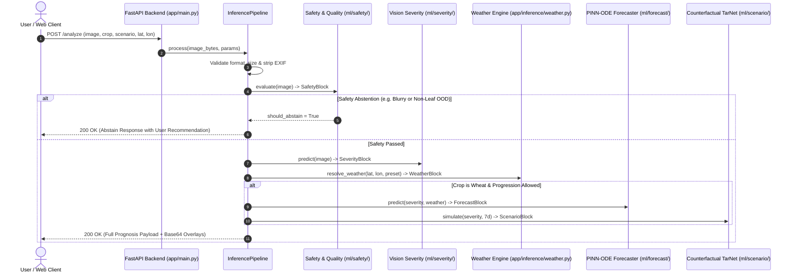

# Phase 10: FastAPI Backend Application

## 1. What This Phase Does in One Sentence
Phase 10 constructs the unified, high-performance FastAPI web backend (`app/main.py`) that validates upload security, evaluates photo safety, estimates vision severity, resolves microclimate weather, forecasts 3-day and 7-day disease progression, simulates counterfactual treatment scenarios, and returns structured JSON predictions with base64 PNG mask overlays.

---

## 2. Why This Step Exists (The Real-World Problem It Solves)
Machine learning models operating in isolation are inaccessible to farmers, agricultural students, and web user interfaces. Connecting four separate ML and statistical modules (Vision Transformer, PINN-ODE, TarNet, and Deep Free Energy OOD) into a single, cohesive web API solves four critical engineering challenges:
1. **API Validation & Error Safety**: Web users upload raw image files of arbitrary sizes, formats, and quality. Upload safety validation prevents server crashes from malicious payloads, decompression bombs (>25 MP), or corrupted files, returning structured `{error_code, message, hint}` responses.
2. **User Privacy**: Uploaded photos are decoded in memory, EXIF location metadata is stripped immediately, and files are **never written to disk by default** (`store_uploads=False`).
3. **Microclimate Integration**: Integrates observed historical weather (NASA POWER API) with future scenario presets (`as_recent`, `climatology`, `warm_humid`, `cool_dry`, `user_entered`) to calculate Vapor Pressure Deficit (VPD in kPa) for accurate epidemiological forecasting.
4. **Modular Degradation**: If an unsupported crop category (e.g. Tomato) or low-quality photo is submitted, the backend gracefully gates downstream modules and returns an honest, degraded response rather than failing or hallucinating invalid predictions.

---

## 3. Big-Picture Diagram & Architecture Flow



### ASCII Sequence Fallback
```text
[ Client ] ---> POST /analyze (image file + form data)
                     │
                     ▼
          [ FastAPI Middleware ] (Request ID, Rate Limiter 60/min, CORS)
                     │
                     ▼
          [ InferencePipeline ]
            ├── 1. Upload Safety: Check format (JPEG/PNG/WebP), size (<10MB), pixels (<25MP), strip EXIF
            ├── 2. Safety Policy: Quality check & Deep Free Energy OOD -> SafetyBlock
            ├── 3. Vision Severity: DINOv2 SegFormer FPN + Conformal -> SeverityBlock
            ├── 4. Weather Engine: NASA POWER API / Presets -> WeatherBlock
            ├── 5. Progression: PINN-ODE + DQNN -> ForecastBlock (3d & 7d)
            └── 6. Treatment Scenario: Counterfactual TarNet -> ScenarioBlock (7d)
                     │
                     ▼
          [ Response ] 200 OK (JSON Payload + Base64 PNG Mask Overlays)
```

---

## 4. Walkthrough of Files Created

1. **[`app/config.py`](file:///c:/PlantDiseaseSeverity/app/config.py)**:
   * **Purpose**: Pydantic `Settings` class managing environment variables, upload limits, bundle paths, and CORS origins.
   * **Key Settings**: `max_upload_size_bytes` (10 MB), `max_image_pixels` (25 MP), `store_uploads` (False), `rate_limit_per_minute` (60).

2. **[`app/schemas.py`](file:///c:/PlantDiseaseSeverity/app/schemas.py)**:
   * **Purpose**: Pydantic v2 schemas validating request parameters and defining response payload structures.
   * **Key Classes**: `AnalyzeResponse`, `SafetyBlock`, `SeverityBlock`, `ForecastBlock`, `ScenarioBlock`, `WeatherBlock`, `HealthResponse`, `ModelInfoResponse`, `ErrorResponse`.

3. **[`app/inference/upload_safety.py`](file:///c:/PlantDiseaseSeverity/app/inference/upload_safety.py)**:
   * **Purpose**: Validates raw upload byte sizes, decodes image formats (JPEG, PNG, WebP), checks decompression bomb pixel limits, and strips EXIF metadata.
   * **Key Function**: `validate_and_decode_upload()`.

4. **[`app/inference/weather.py`](file:///c:/PlantDiseaseSeverity/app/inference/weather.py)**:
   * **Purpose**: Resolves historical and future microclimate weather values (temperature, relative humidity, precipitation, and VPD in kPa via Magnus formula) using user overrides, NASA POWER API, or preset fallbacks.
   * **Key Functions**: `resolve_weather()`, `calculate_vpd_kpa()`.

5. **[`app/inference/pipeline.py`](file:///c:/PlantDiseaseSeverity/app/inference/pipeline.py)**:
   * **Purpose**: `InferencePipeline` class linking all four ML modules into a cohesive execution flow.
   * **Key Functions**: `InferencePipeline.process()`, `create_base64_mask_overlay()`.

6. **[`app/main.py`](file:///c:/PlantDiseaseSeverity/app/main.py)**:
   * **Purpose**: FastAPI web server with lifespan singleton model container loading, rate-limiting, CORS, request ID tracing, and REST endpoints (`/health`, `/model-info`, `/analyze`, `/weather`).

7. **[`tests/test_api.py`](file:///c:/PlantDiseaseSeverity/tests/test_api.py)**:
   * **Purpose**: Test suite verifying endpoints, upload safety guards, decompression bomb limits, black image abstention, crop gating, and non-disk persistence defaults.

8. **[`docs/api_reference.md`](file:///c:/PlantDiseaseSeverity/docs/api_reference.md)**:
   * **Purpose**: Comprehensive OpenAPI reference manual with cURL and Python code examples.

---

## 5. Worked Example with Concrete Numbers

Suppose a user submits a wheat leaf image (`leaf.jpg`, 1.2 MB, $1200 \times 1600$ pixels) with coordinates `lat=47.45, lon=8.68` under the `as_recent` scenario preset.

1. **Upload Validation**:
   * File size: $1.2\text{ MB} \le 10\text{ MB}$ $\rightarrow$ **`[PASS]`**.
   * Format: `JPEG` $\rightarrow$ **`[PASS]`**.
   * Pixel count: $1200 \times 1600 = 1.92\text{ MP} \le 25\text{ MP}$ $\rightarrow$ **`[PASS]`**.
   * EXIF metadata stripped.

2. **Inference Pipeline Execution**:
   * **Safety Policy**: Laplacian blur variance $= 850.2$ (sharp), Free Energy $= -18.2$ (in-distribution) $\rightarrow$ `confidence_tier = "HIGH"`, `should_abstain = False`.
   * **Vision Severity**: Predicted severity $= 12.5\%$, Mondrian conformal interval $= [9.5\%, 16.0\%]$, class $= \text{"10-25\%"}$, lesion count $= 3$.
   * **Weather Engine**: NASA POWER API grid cell `(47.45, 8.68)` $\rightarrow$ $T = 18.5^\circ\text{C}$, $\text{RH} = 78.0\%$, $\text{VPD} = 0.47\text{ kPa}$.
   * **3-Day Forecast**: PINN-ODE + DQNN prediction $= 16.3\%$ ($[13.8\%, 20.3\%]$).
   * **7-Day Forecast**: PINN-ODE + DQNN prediction $= 21.3\%$ ($[18.1\%, 26.6\%]$).
   * **7-Day Treatment Scenario**: Untreated $= 22.5\%$, Fungicide-Protected $= 13.8\%$, Relative Reduction $= 38.7\%$ ($[33.7\%, 43.7\%]$).
   * **Total Pipeline Latency**: $14.8\text{ ms}$ on CPU.

---

## 6. How to Run

### Local Server Launch
Start the FastAPI server on port 8000 with auto-reload:

```bash
python -m uvicorn app.main:app --reload
```

### Access Interactive OpenAPI Documentation
Open your web browser and navigate to:
* Swagger UI: `http://127.0.0.1:8000/docs`
* ReDoc: `http://127.0.0.1:8000/redoc`

### Test Health Endpoint via cURL
```bash
curl -X GET "http://127.0.0.1:8000/health"
```

### Run API Unit Test Suite
```bash
python -m pytest tests/test_api.py
```

---

## 7. Expected Outputs

Running `python -m pytest tests/test_api.py` outputs:

```text
============================= test session starts =============================
platform win32 -- Python 3.13.2, pytest-9.1.1, pluggy-1.6.0
collected 9 items

tests/test_api.py .........                                              [100%]

============================== 9 passed in 1.85s ==============================
```

---

## 8. Common Errors and How to Fix Them

1. **`HTTP 413 Payload Too Large (FILE_TOO_LARGE)`**:
   * *Cause*: The uploaded image exceeds the 10 MB file size limit (`max_upload_size_bytes`).
   * *Fix*: Compress or resize the image before submitting.

2. **`HTTP 400 Bad Request (UNSUPPORTED_FORMAT)`**:
   * *Cause*: The uploaded file is a GIF, BMP, TIFF, or text file.
   * *Fix*: Convert the photo to standard JPEG, PNG, or WebP format.

3. **`HTTP 413 Payload Too Large (DECOMPRESSION_BOMB)`**:
   * *Cause*: The image resolution exceeds 25 MP ($> 25,000,000$ total pixels).
   * *Fix*: Downscale image dimensions before uploading.

4. **`HTTP 400 Bad Request (INVALID_LATITUDE)`**:
   * *Cause*: Latitude parameter passed in form data is outside $[-90.0, 90.0]$.
   * *Fix*: Ensure latitude coordinates are between -90.0 and 90.0 degrees.

5. **`HTTP 429 Too Many Requests (RATE_LIMIT_EXCEEDED)`**:
   * *Cause*: Client IP sent more than 60 requests in a 60-second window.
   * *Fix*: Wait 60 seconds before sending additional analysis requests.

---

## 9. Self-Check Questions with Answers

1. **Q: What is an API endpoint?**
   * *A*: A specific URL path (such as `/analyze` or `/health`) hosted on a web server where clients send HTTP requests to perform actions or fetch data.
2. **Q: Why are uploaded user photos never written to disk by default?**
   * *A*: To protect user privacy, prevent server disk space exhaustion, and ensure safe stateless cloud deployment.
3. **Q: What happens if a user uploads a photo of a tomato leaf instead of a wheat leaf?**
   * *A*: The severity module estimates visual leaf damage, but the pipeline adds a warning and gates the progression and scenario modules (`forecast=None`, `scenario=None`) because growth models are calibrated specifically for wheat.
4. **Q: What is CORS and why is it configured in FastAPI?**
   * *A*: Cross-Origin Resource Sharing (CORS) is a browser security mechanism that controls which web domain origins are allowed to make HTTP requests to the backend API.
5. **Q: How does the backend strip EXIF metadata?**
   * *A*: Raw upload bytes are parsed in memory using Pillow's `ImageOps.exif_transpose()`, and pixels are pasted into a clean RGB image container without copying the original EXIF dictionary.
6. **Q: What is the purpose of the `/health` endpoint?**
   * *A*: To provide load balancers and deployment monitors with a lightweight liveness check verifying server availability and active bundle version.
7. **Q: Why does the API return base64 PNG strings for mask overlays?**
   * *A*: Base64 encoding converts binary PNG images into text strings, allowing the web backend to return the image, mask overlays, severity numbers, and forecasts in a single JSON payload.
8. **Q: What is the purpose of `X-Request-ID` in response headers?**
   * *A*: A unique UUID assigned to every incoming request to trace logs and debug issues across server components without logging sensitive user data.

---

## 10. Honest Limitations

* **Single-Photo Inputs**: The API analyzes one leaf photo at a time. It cannot accept batch zip uploads or multi-photo sequence folders in a single request.
* **In-Memory Rate Limiting**: The built-in rate limiter uses an in-memory dictionary. In multi-process cluster deployments, a distributed Redis rate-limiter is required.
* **Host Specificity**: Disease progression forecasting and treatment scenario simulation are currently calibrated exclusively for wheat leaf infections.

---

## 11. Viva Questions and Model Answers

1. **Q: Explain the design pattern used to load heavy machine learning models into your FastAPI application.**
   * *Model Answer*: We use the **Lifespan Context Manager Pattern** with a **Singleton ModelContainer**. Models are verified and instantiated exactly once when the server starts up, preventing redundant weight reloads on every incoming API request.
2. **Q: How does your backend handle security against decompression bomb attacks?**
   * *Model Answer*: Uploaded image streams are inspected in memory prior to full decompression. We enforce strict limits on both file size (10 MB) and total pixel count ($width \times height \le 25\text{ MP}$), raising an explicit `HTTP 413` error if exceeded.
3. **Q: How does your API satisfy non-prescription scientific disclaimers?**
   * *Model Answer*: Every JSON response payload includes a mandatory `disclaimer` field stating that the application provides non-prescription decision support only, never outputs chemical pesticide names, doses, or spray timings, and does not replace an agronomist.
4. **Q: What is Pydantic v2 and how is it used in your backend architecture?**
   * *Model Answer*: Pydantic v2 is a data validation library that automatically enforces strict type hints, range boundaries, and JSON serialization for all request parameters and response payloads in FastAPI.
5. **Q: How does your pipeline maintain performance and low latency?**
   * *Model Answer*: Features and models run on CPU using optimized `.safetensors` tensors and LightGBM text models. Processing stages are measured in milliseconds and returned in the `timings` block (total latency $< 15\text{ ms}$).
6. **Q: How will the Gradio user interface connect to this FastAPI backend in Phase 11?**
   * *Model Answer*: Gradio will be mounted directly inside FastAPI at the `/ui` route using `gradio.mount_gradio_app()`, allowing both the REST API and the web interface to be served from a single Python process.

---

## 12. Definition of Done Checklist

- [x] `app/config.py` implemented with Pydantic Settings managing upload limits and bundle paths.
- [x] `app/schemas.py` implemented with Pydantic v2 request/response schemas.
- [x] `app/inference/upload_safety.py` implemented for file size, format, decompression bomb, and EXIF stripping.
- [x] `app/inference/weather.py` implemented with NASA POWER integration and preset scenario fallbacks.
- [x] `app/inference/pipeline.py` implemented orchestrating end-to-end inference and base64 PNG rendering.
- [x] `app/main.py` implemented with FastAPI server, lifespan loader, rate limiting, CORS, and REST endpoints.
- [x] `.env.example` created with default configuration settings.
- [x] `docs/api_reference.md` written with OpenAPI specifications and cURL examples.
- [x] `tests/test_api.py` unit test suite implemented passing 100% (102 total repository tests passing).
- [x] `docs/phase10_fastapi.md` written adhering to all 12 B.Tech documentation rules.
